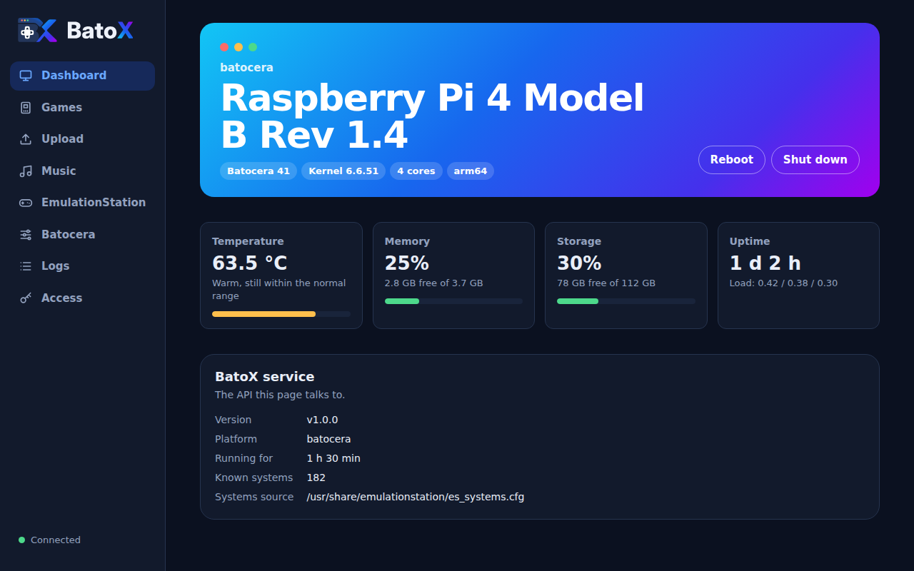
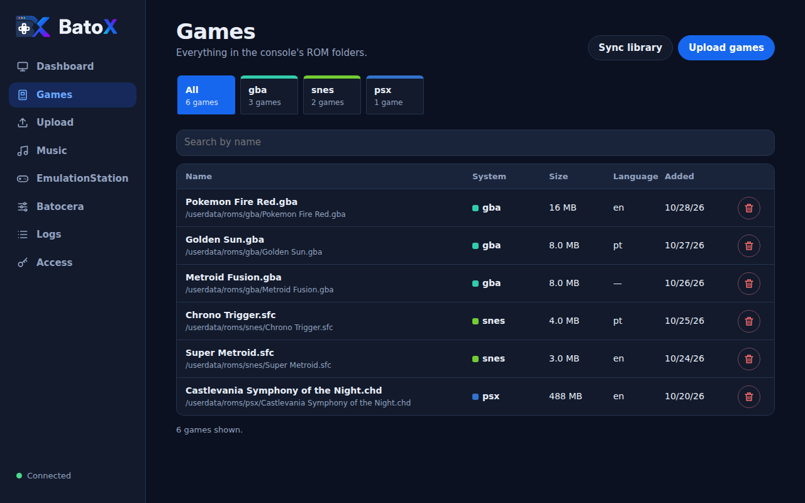
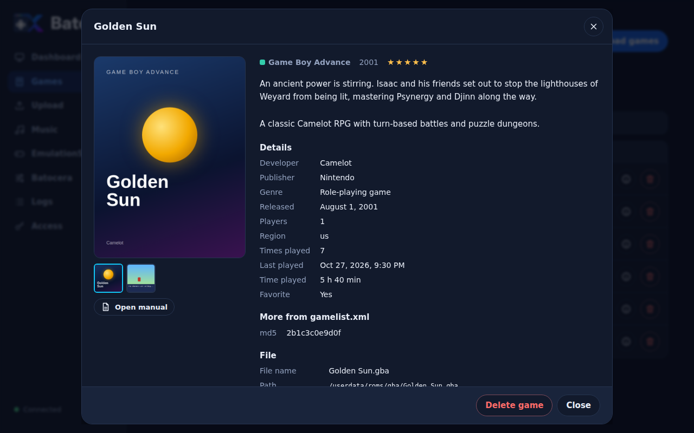
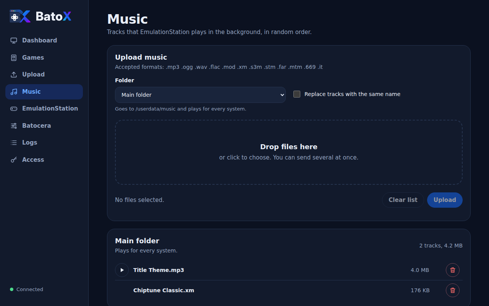
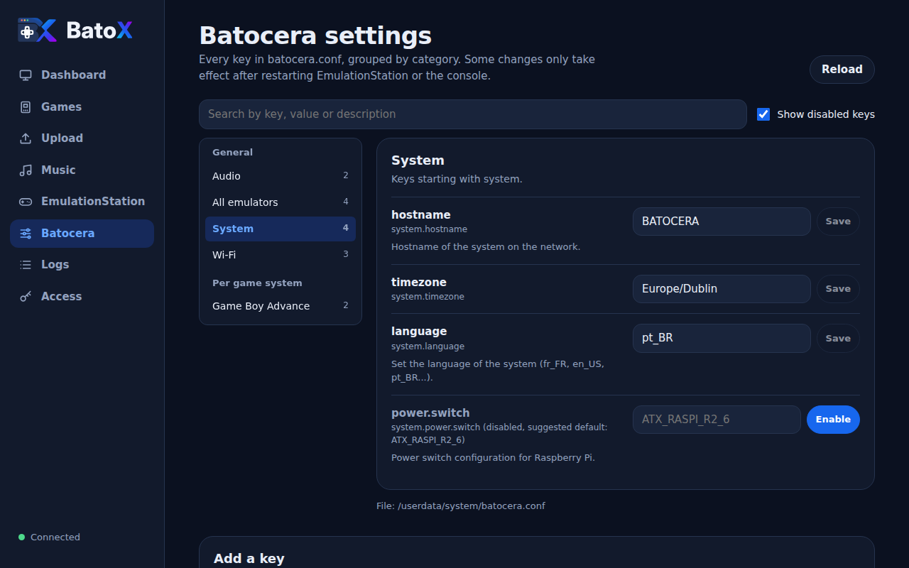

<p align="center">
  <picture>
    <source media="(prefers-color-scheme: dark)" srcset="docs/assets/batox-logo-dark.svg">
    
  </picture>
</p>

<p align="center">
  <strong>A web app and REST API to manage your Batocera console from any browser on your network.</strong>
</p>

<p align="center">
  <a href="https://github.com/monteirohat/batox/actions/workflows/ci.yml"></a>
  <a href="https://github.com/monteirohat/batox/releases"></a>
  <a href="go.mod"></a>
  <a href="LICENSE"></a>
</p>

---

BatoX runs as a small service on your [Batocera](https://batocera.org) machine and serves a
management page at `http://batocera.local:8080`. From your phone or laptop you can upload games
and music, browse your library, tweak EmulationStation and Batocera settings, install themes and
keep an eye on the hardware, without pulling the SD card or opening a network share.

It is a single self-contained binary: the web app is embedded, the catalog uses a pure-Go SQLite
driver, and there are no runtime dependencies to install on the console. The easiest way to get it
there is the **[BatoX Installer](https://github.com/monteirohat/BatoX_Installer)**, a desktop app that installs and updates BatoX in a few
clicks, no terminal needed.

<p align="center">
  
</p>

## Features

- **Dashboard** with the board model, Batocera version, temperature, memory, storage and uptime,
  plus reboot and shutdown.
- **Now playing**: the game being played, with its cover and for how long, and shortcuts to send a
  message, see its details or close it.
- **Game library** with a per-system filter, search, deletion and a sync that detects new, moved,
  renamed, duplicated and removed ROMs.
- **Game details** for every game: the description, artwork, video, manual, developer, rating,
  play count and the rest of what EmulationStation scraped into `gamelist.xml`, plus the file
  data.
- **Play on the console** from the games list, switching from the game being played when needed.
- **Consoles**: every system Batocera can emulate, with the theme's logo, manufacturer, release
  year, type and the games you have, filtered by type and searchable.
- **Game uploads** of many files at once, with progress bars. Accepted extensions come straight
  from Batocera's own `es_systems.cfg`, so BatoX accepts exactly what EmulationStation can list.
- **Background music** for EmulationStation: upload to the main folder or to a per-system folder,
  preview tracks in the browser, and delete them.
- **EmulationStation controls**: reload game lists, restart, stop and start, edit
  `es_settings.cfg`, install themes from a ZIP, and read or clear the log.
- **Timer**: limit play time with a countdown in a corner of the TV; at zero, BatoX closes the game
  or turns the console off.
- **Messages to the console**: send a message to the TV screen ("Dinner is ready!"), drawn on top
  of the game too, with a choice of position, duration and title. Uses the
  [BatoX Apps](https://github.com/monteirohat/batox-apps) overlay, built into BatoX.
- **Batocera settings**: every `batocera.conf` key grouped by category, with descriptions, search,
  and the commented-out defaults that Batocera ships as suggestions.
- **REST API** for everything above, protected by a token. See the [API reference](docs/api.md).
- Works on **Raspberry Pi (arm64)** and **x86_64 PCs** running Batocera v38 or newer.

| Games | Game details |
|---|---|
|  |  |

| Music | Batocera settings |
|---|---|
|  |  |

## Quick start

You need a Batocera v38+ machine on your network with SSH enabled (it is on by default). The SSH
user is `root` and the default password is `linux`.

### Option 1: BatoX Installer (recommended)

The **[BatoX Installer](https://github.com/monteirohat/BatoX_Installer)** is a desktop app for Windows, macOS and Linux, in the style of
balenaEtcher. It downloads the BatoX release you choose from GitHub, checks your console, installs
or updates BatoX over SSH, and shows you the address and the API token at the end.

<p align="center">
  <a href="https://github.com/monteirohat/BatoX_Installer"></a>
</p>

1. Download it from the [BatoX Installer releases](https://github.com/monteirohat/BatoX_Installer/releases/latest).
2. Pick a version (the latest is selected), enter `batocera.local` or the console's IP address,
   and click **Check console**.
3. Click **Install**. Use the same app later to update to a new version.

### Option 2: install a release by hand

Download `batox-linux-arm64` (Raspberry Pi) or `batox-linux-amd64` (PC) and the `batox` service
script from the [latest release](https://github.com/monteirohat/batox/releases), then run:

```bash
HOST=batocera.local
ARCH=arm64   # or amd64

ssh root@$HOST "mkdir -p /userdata/system/batox /userdata/system/services"
scp batox-linux-$ARCH root@$HOST:/userdata/system/batox/batox
scp batox root@$HOST:/userdata/system/services/batox
ssh root@$HOST "chmod +x /userdata/system/batox/batox /userdata/system/services/batox \
  && batocera-services enable batox && batocera-services start batox \
  && sleep 2 && cat /userdata/system/batox/token"
```

### Option 3: build from source

Requires Go 1.24+ and `make`:

```bash
git clone https://github.com/monteirohat/batox.git
cd batox
ssh-copy-id root@batocera.local   # optional: avoids typing the password on every deploy
make deploy                       # BATOCERA_HOST=192.168.1.50 make deploy to use an IP
                                  # BATOX_ARCH=amd64 make deploy for a PC
```

`make deploy` builds the binary, installs the service, starts it, checks the API and prints the
token.

### Open the web app

Go to **http://batocera.local:8080**. On the first visit, open the **Access** screen, paste the
token and click **Save and test**. The token is stored only in that browser.

The BatoX Installer shows the token at the end; with the other options, read it with
`ssh root@batocera.local cat /userdata/system/batox/token`.

See the [installation guide](docs/installation.md) for SSH setup, upgrades, uninstalling and
troubleshooting.

## Documentation

| Guide | What it covers |
|---|---|
| [BatoX Installer](https://github.com/monteirohat/BatoX_Installer) | Desktop app that installs and updates BatoX for you |
| [Installation](docs/installation.md) | SSH access, installing, upgrading (including from MyMine), uninstalling, troubleshooting |
| [Configuration](docs/configuration.md) | `config.json` options, environment variables, file locations |
| [API reference](docs/api.md) | Authentication, error format and every endpoint |
| [Development](docs/development.md) | Project layout, dev mode, tests, frontend architecture, releases |

A [Postman collection](postman_collection.json) with every endpoint is included.

## Updating

Open the [BatoX Installer](https://github.com/monteirohat/BatoX_Installer), choose the new version and click **Update**, or run
`make deploy` again from a clone of this repository. Both keep your token, settings and game
catalog.

## Upgrading from MyMine

BatoX was previously called MyMine. The [BatoX Installer](https://github.com/monteirohat/BatoX_Installer) and `make deploy` (or
`./scripts/deploy.sh deploy`) both detect an existing MyMine install, stop and remove the old
service, and move its data to `/userdata/system/batox`, keeping your token and game catalog. The web app also carries over the
token saved in your browser. See [Installation](docs/installation.md#upgrading-from-mymine).

## Security

BatoX is meant for your **home network**. It runs as `root` on the console (as every Batocera
service does) and can delete files, change settings and power the machine off, so:

- every API route except `/api/v1/ping` and `/api/v1/about` requires the token;
- uploads are validated against path traversal and "zip slip", and are written straight to disk;
- there is no endpoint that runs arbitrary commands.

Do not expose port 8080 to the internet. See [SECURITY.md](SECURITY.md) for details and how to
report a vulnerability.

## Roadmap

- Interface translations, with a language switch
- Scraped media (box art) in the game library
- Save-state and screenshot browsing
- Per-game settings editor

Ideas and pull requests are welcome; see [CONTRIBUTING.md](CONTRIBUTING.md).

## Related projects

- **[BatoX Installer](https://github.com/monteirohat/BatoX_Installer)**: the desktop app that installs and updates BatoX on a Batocera
  console (Electron, React and TypeScript).

## License

[MIT](LICENSE)

BatoX is an independent project. It is not affiliated with or endorsed by the Batocera project.
Batocera is a trademark of its respective owners.
